<!-- Replace TMAn1An with your GitHub username if different -->

## 📊 GitHub Stats

## 🐍 Contribution Snake

<picture>
  <source media="(prefers-color-scheme: dark)" srcset="https://raw.githubusercontent.com/TMAn1An/TMAn1An/output/github-snake-dark.svg" />
  <source media="(prefers-color-scheme: light)" srcset="https://raw.githubusercontent.com/TMAn1An/TMAn1An/output/github-snake.svg" />
  
</picture>

## 🎮 Contribution Breakout

<picture>
  <source media="(prefers-color-scheme: dark)" srcset="https://raw.githubusercontent.com/TMAn1An/TMAn1An/github-breakout/images/breakout-dark.svg" />
  <source media="(prefers-color-scheme: light)" srcset="https://raw.githubusercontent.com/TMAn1An/TMAn1An/github-breakout/images/breakout-light.svg" />
  
</picture>

